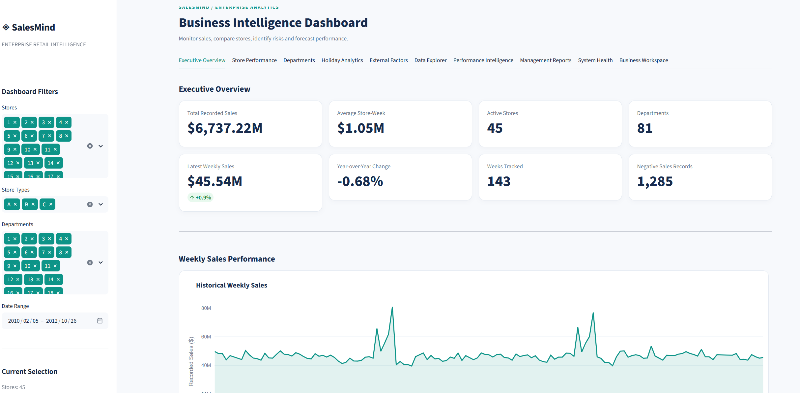
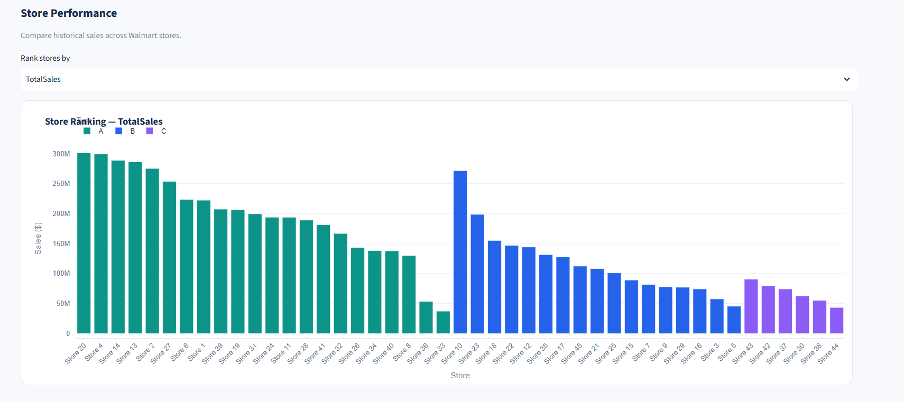
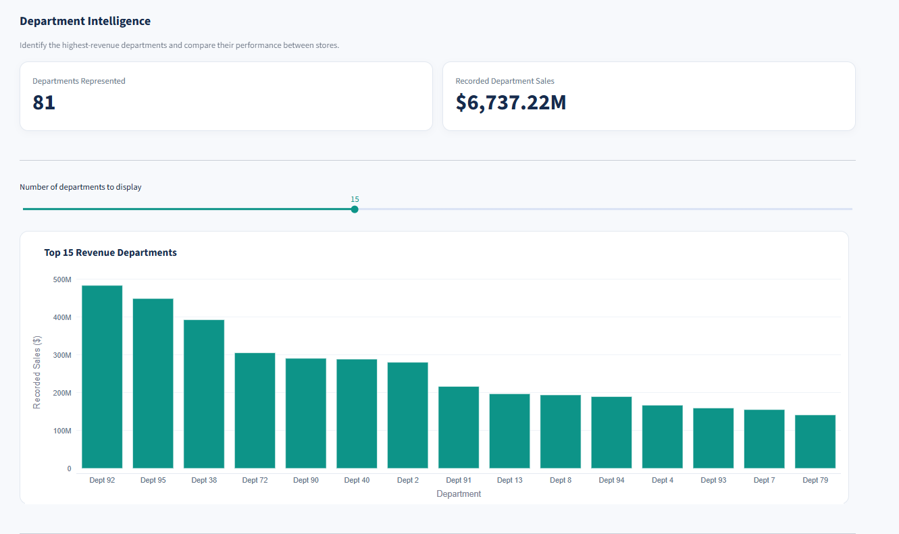
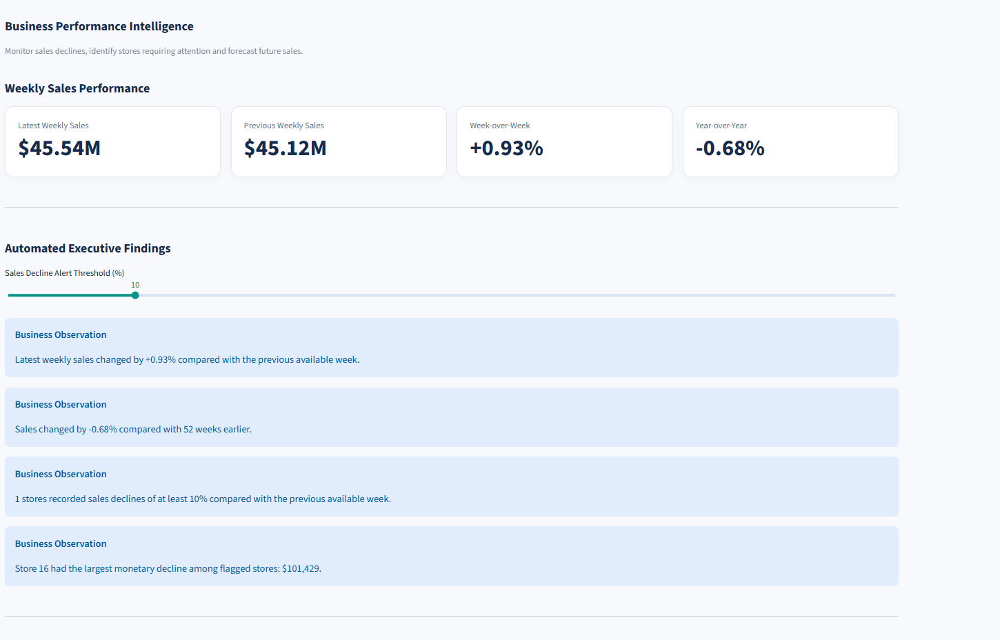
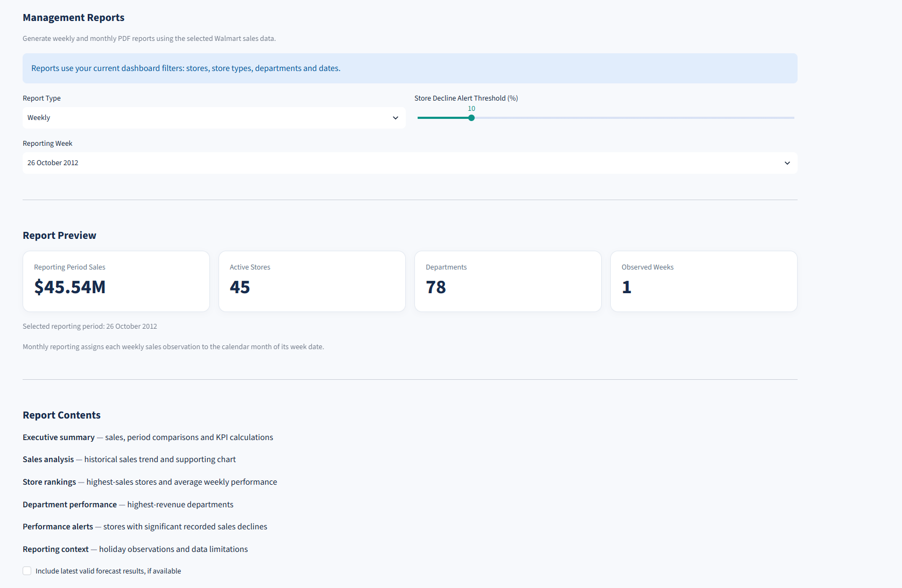

# 📊 SalesMind AI
### Retail Sales Intelligence & Machine Learning Forecasting

**SalesMind AI** is an end-to-end retail business intelligence application developed using Python, Streamlit, Pandas, Plotly, and scikit-learn.

The project transforms historical Walmart sales data into interactive dashboards, actionable business observations, sales performance alerts, and machine learning forecasts.

It also provides automated PDF management reports, data-quality validation, and forecasting backtesting.

This project demonstrates practical skills in **data engineering, exploratory data analysis, machine learning, data visualization, software development, and automated testing**.

---

## 🚀 Key Features

### 📈 Executive Dashboard
- Total sales and average weekly store performance
- Interactive weekly sales trends
- Top-performing stores and store-type comparisons
- Automated data-driven executive findings
- Interactive filters for stores, departments, and dates

### 🏬 Store & Department Analytics
- Rankings of 45 Walmart stores
- Store-to-store performance comparison
- Department-level sales analysis
- Interactive store-department heatmaps
- Identification of high-performing business units

### 📅 Holiday & Economic Analysis
- Holiday versus regular-week sales comparisons
- Temperature, fuel price, CPI, and unemployment analysis
- Promotional markdown correlations
- Historical trend exploration

### 🚨 Performance Intelligence
- Week-over-week and year-over-year comparisons
- Automated store and department sales decline detection
- Configurable alert thresholds
- Severity indicators and performance rankings

### 🤖 Machine Learning Forecasting
- Random Forest regression
- Historical lag features and rolling averages
- Recursive multi-week sales predictions
- Chronological train/test evaluation
- Comparison against historical baseline forecasting methods
- Expanding-window backtesting

**Evaluation metrics:**
- Mean Absolute Error (MAE)
- Root Mean Squared Error (RMSE)
- Weighted Absolute Percentage Error (WAPE)

### 📄 Automated Management Reports
- Weekly and monthly downloadable PDF reports
- Executive sales summaries
- Store and department rankings
- Revenue decline alerts
- Historical sales charts
- Optional forecasting evaluation information

### ✅ Data Validation & Testing
- Dataset schema validation
- Duplicate and missing-value detection
- Store-week coverage checks
- Dashboard and PDF metric reconciliation
- Automated testing using pytest

---

## 🖼️ Dashboard Screenshots

### Executive Overview



### Store Performance



### Department Analytics



### Machine Learning Forecasting



### Management Reports



---

## 🛠️ Technologies Used

| Technology | Purpose |
|---|---|
| Python | Application development |
| Pandas | Data cleaning and analytics |
| NumPy | Numerical computations |
| Streamlit | Interactive web dashboard |
| Plotly | Business intelligence visualizations |
| scikit-learn | Machine learning and forecasting |
| Matplotlib | PDF report charts |
| ReportLab | PDF generation |
| pytest | Automated unit testing |
| pypdf | PDF verification tests |

---

## 📂 Project Structure

```text
SalesMind-AI/
├── .streamlit/
│   └── config.toml
├── data/
│   └── README.md
├── docs/
│   └── screenshots/
├── modules/
│   ├── data_loader.py
│   ├── analytics.py
│   ├── advanced_analytics.py
│   ├── performance_intelligence.py
│   ├── forecasting.py
│   ├── backtesting.py
│   ├── report_generator.py
│   ├── data_validation.py
│   └── ui.py
├── tests/
├── app.py
├── requirements.txt
├── pytest.ini
├── .gitignore
└── README.md
```

The structure above represents the focused Walmart portfolio version.

---

## 📊 Dataset

The application uses the **Walmart Recruiting — Store Sales Forecasting** dataset from Kaggle.

**Dataset:** https://www.kaggle.com/competitions/walmart-recruiting-store-sales-forecasting/data

The dataset contains historical weekly department-level sales observations from 45 Walmart stores, along with store characteristics, holiday indicators, promotional markdown data, and regional economic indicators.

**Required files:**
- `train.csv`
- `features.csv`
- `stores.csv`

The dataset covers historical observations from 2010–2012.

The original dataset files are not distributed with this repository. Download them separately from Kaggle and place them inside the `data/` directory.

**Important limitations:** Sales do not represent profit; departments are anonymized; individual customer and product transactions are unavailable. Economic correlations and alerts are descriptive rather than causal.

---

## 💻 Installation

### 1. Clone the repository

```bash
git clone https://github.com/odaynasrawi123/SalesMind-AI.git
cd SalesMind-AI
```

### 2. Create a virtual environment

```bash
python -m venv .venv
```

Activate it on Windows:

```powershell
.venv\Scripts\Activate.ps1
```

### 3. Install dependencies

```bash
python -m pip install -r requirements.txt
```

### 4. Download the dataset

Download the Walmart dataset from Kaggle and extract the following files:

```text
data/
├── train.csv
├── features.csv
└── stores.csv
```

### 5. Run the application

```bash
python -m streamlit run app.py
```

The dashboard will open in your browser, normally at:

http://localhost:8501

---

## 🧪 Automated Testing

Run the test suite using:

```bash
python -m pytest -v
```

The tests cover data validation, sales calculations, performance monitoring, forecasting behavior, and PDF report generation.

---

## 🧠 Machine Learning Methodology

Sales forecasting uses a Random Forest regressor trained on historical weekly sales patterns.

The process includes:

1. Aggregating selected Walmart store and department sales by week.
2. Creating historical lag and rolling-average features.
3. Adding calendar-based seasonal features.
4. Splitting data chronologically into training and testing periods.
5. Training the Random Forest model.
6. Evaluating historical predictions against actual recorded sales.
7. Comparing model results against baseline forecasting approaches.
8. Generating recursive multi-week forecasts.

Additional expanding-window backtesting evaluates model performance across multiple historical periods.

Forecasting accuracy is assessed using MAE, RMSE, and WAPE. No performance score is claimed without running the model on the selected data.

---

## 🎯 Project Objectives

SalesMind AI was developed to:

- Convert raw retail sales data into meaningful business information.
- Provide an intuitive interface for investigating sales performance.
- Detect historical changes and underperforming stores.
- Evaluate whether machine learning improves forecasting compared with simpler models.
- Automate management reporting.
- Apply modular software engineering and testing practices to a data analytics application.

---

## ⚠️ Disclaimer

SalesMind AI is an independent educational and portfolio project.

It is not affiliated with, endorsed by, or operated by Walmart.

The application uses historical Kaggle competition data and is not intended to represent Walmart's current operations or provide verified financial advice.

---

## 👨‍💻 Author

**Oday Nasrawi**

Software & Validation Engineer | Python Developer | Data Science

**GitHub:** https://github.com/odaynasrawi123
